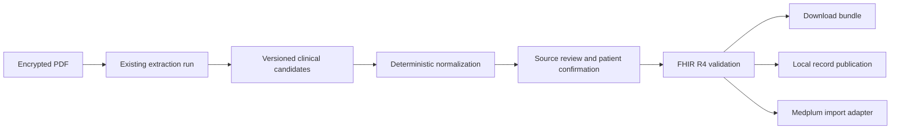

# PDF extraction conversion to FHIR and Medplum

Date: October 15, 2026. Status: proposed implementation plan.

The current extraction pipeline is a useful foundation for FHIR conversion. Document packaging is straightforward; trustworthy conversion of individual clinical facts needs a normalization and review layer. Start with FHIR R4 documents and reviewed laboratory results and vitals. Keep the original PDF, every extraction run, and the evidence behind each exported field.

Medplum can be a destination for the same FHIR resources. Its API uses FHIR R4, so a separate proprietary clinical representation is unnecessary. Keep conversion independent of transport so downloads, local records, and Medplum imports share the mapper. [Medplum API](https://www.medplum.com/docs/api)

The default first deliverable is a downloadable FHIR bundle for selected PDFs. Live import and timeline integration are separate milestones. The feasibility assessment below is based on this checkout and public specifications; accuracy on an owner's documents must be measured through an authenticated review workflow.

## Current capabilities and gaps

| Existing capability | Reuse and remaining work |
| --- | --- |
| Native PDF parsing, selective Tesseract fallback, optional OCR adapters | Reuse parsing. A new FHIR mapper should consume completed runs rather than repeat OCR. |
| Page text, word boxes, tables, figures, source SHA-256, tool and model manifests | Reuse for traceability and visual review. Add stable field evidence spans and links between table rows and headers. |
| Measurement tuples containing name, value, unit, date, range, page, evidence | These can seed Observation candidates. They lack typed quantities, terminology, patient association, result status, specimen, method, and panel relationships. |
| Exact evidence checks in Python and Zod | These reject unsupported quotations. They do not establish that a value belongs to the named test, date, or patient. |
| Encrypted immutable extraction runs and reference labels | Preserve them. Store mapping results and review decisions separately with their own versions. |
| Encrypted FHIR record storage, timeline normalizers, and collection export | Reuse after review. Add an explicit uploaded-document source and origin/review display. |
| Reviewed-reference metrics and synthetic fixtures | Extend these for clinical semantics and FHIR conformance. Existing synthetic successes do not establish document-level accuracy in real uploads. |

Code anchors: [extraction contract](../../../src/lib/extraction/contracts.ts), [clinical inference](../../../services/extraction/inference.py), [worker and evaluation documentation](../../../services/extraction/README.md), [extraction persistence](../../../src/lib/extraction/store.ts), [record schema](../../../src/lib/db/records-schema.ts), [FHIR reader types](../../../src/lib/fhir/types.ts), [existing export](../../../src/lib/export.ts).

Important limits in the current implementation:

- Every measurement field must occur in one exact quote on one page. A date in a report header and a value in a later table row cannot reliably be associated through this contract. Empty strings pass substring checks, so an accepted candidate can still have no usable unit or date.
- Evidence presence does not prove the relationship between fields. A quote spanning several rows can contain all required strings while associating the wrong value with a test. Add row and column relationships and field-specific evidence.
- Deduplication currently removes identical candidate objects. Different quotes or page positions can preserve the same clinical result more than once. Conversely, equal values can be separate observations.
- Inference processes up to eight 20,000-character chunks per task, with a soft ten-minute budget. Partial measurements remain available with warnings. A completed extraction job therefore does not imply a complete clinical abstraction.
- `summaryStatus: accepted` means the summary passed the implemented format/privacy checks. It does not mean a person verified the clinical content. Generate structured facts from source evidence rather than the summary.
- `src/lib/fhir/types.ts` intentionally makes reader fields optional. Use complete FHIR R4 types plus runtime/profile validation for authored exports.
- `src/lib/export.ts` currently emits `total` on a `collection` Bundle. That violates R4 invariant `bdl-1`, which permits `total` only on search or history bundles. Fix this existing conformance issue before extending the exporter, and validate Bundle rules as well as individual resources. [FHIR R4 Bundle constraints](https://hl7.org/fhir/R4/bundle.html#invs)
- `health_source.vendor` currently supports Epic and Metriport. PDF records need an explicit new origin; otherwise the app could present them as health-system imports. A PDF publication path must also avoid remote full-sync removal logic.
- The extraction README mentions a separate Matrix/Medplum deployment, but this checkout contains no Medplum export adapter. Its running version, project features, and access policies remain deployment discovery work.

## Feasibility by data type

| Content | FHIR representation | Assessment and first scope |
| --- | --- | --- |
| Original PDF and document metadata | DocumentReference with Binary or an authenticated attachment service | High feasibility. This provides useful document exchange even without reliable fact extraction. |
| Individual laboratory results and vitals | Observation; DiagnosticReport for an actual report grouping | Good first clinical scope with review. Handle numeric comparators, units, reference ranges, dates, and row association. |
| Imaging or pathology report text | DocumentReference; DiagnosticReport when report context is established | Feasible as source text and report metadata. Structure only explicit findings; retain uncertainty. |
| Medication history | MedicationStatement; MedicationRequest only when an actual order is documented | Later scope. Dose, route, frequency, current use, and order intent are distinct facts. |
| Diagnoses, allergies, procedures | Condition, AllergyIntolerance, Procedure | Later scope. Negation, family history, suspected disease, and historical context need explicit extraction and review. |
| Plotted points or medical images | Retained document/image initially | Defer automatic clinical measurements. The existing chart benchmark does not establish measurement or unit accuracy. |

DocumentReference is specifically intended to index PDFs and scanned documents and can point to Binary content or an external service. [FHIR R4 DocumentReference](https://hl7.org/fhir/R4/documentreference.html)

Observations can link to their source DocumentReference through `derivedFrom`; DiagnosticReport can reference its results through `result`. Create report groups from evidence of actual report boundaries, since one PDF may contain multiple reports. [FHIR R4 Observation](https://hl7.org/fhir/R4/observation.html), [FHIR R4 DiagnosticReport](https://hl7.org/fhir/R4/diagnosticreport.html)

## Proposed conversion architecture

Keep the extraction worker responsible for proposing evidence-backed facts. The trusted web backend should own identity binding, review decisions, mapping, validation, and export credentials. Network requests stay outside `asUser` transactions; encrypted state changes occur inside them.

### Candidate representation

Add a versioned intermediate representation containing:

- Immutable extraction run ID and digest, document ID, candidate ID, and mapper version.
- Raw source labels and values alongside normalized values. Preserve the original spelling and unit case.
- Typed values for quantities, comparators such as `<` and `>`, coded results, and text. Keep reference ranges and interpretation separate.
- Separate clinical occurrence, specimen collection, report issue, and document upload dates, including precision and ambiguity.
- Explicit patient-association state. The uploader owns the file but may have uploaded another person's record. Confirm the document subject before clinical publication; mixed-patient documents require segmentation or quarantine.
- Field-specific page, text offsets, and optional boxes, with links from values to table headers and report dates. Inherited context must be evidence-backed.
- Terminology candidates and the evidence for choosing them; missing, conflicting, and unsupported fields; inference completeness; review state and review history.

Use distinct review states such as `needs_review`, `approved`, `rejected`, and `superseded`. OCR confidence and model confidence must remain separate from clinical verification. At first, every clinical candidate requires review; documents can still be packaged without publishing their candidate facts.

### Mapping rules

1. **Patient:** bind the confirmed subject to an explicit patient crosswalk. For Medplum, map within a specific project and environment. Never guess a target Patient from a name match or create a new Patient on every retry.
2. **Codes:** retain source text. Add LOINC only when the required context establishes the concept, including specimen and method when relevant. Use a governed local code or text where the selected profile permits it. Route ambiguous mappings for review.
3. **Quantities:** parse deterministically and preserve comparators. Add UCUM codes only for verified unit mappings. Unknown units remain unknown; avoid automatic scale conversion in the first version.
4. **Dates:** preserve source precision. Do not substitute upload time or a manually supplied encounter anchor for the measurement date. Omit optional missing dates and quarantine invalid or ambiguous dates when required by the target profile.
5. **Status:** source clinical status and extraction review status are separate. Do not assign `final` because a reviewer approved transcription. Use a source-supported status, or `unknown` where the resource and selected profile permit it.
6. **Missing data:** absence from OCR is not evidence of clinical absence. Do not turn an unreadable field into a negative finding or clinical `dataAbsentReason` without supporting source meaning.
7. **Provenance:** link resources to the source document and record software/model, extraction and mapping versions, creation time, and any reviewer. Keep quotes in encrypted evidence storage with resolvable access-controlled pointers. FHIR Provenance can describe the creation and revision activity. [FHIR R4 Provenance](https://hl7.org/fhir/R4/provenance.html)
8. **Identity and duplicates:** allocate stable opaque IDs for document and fact identities. Bind processing to owner, file, confirmed patient, run digest, and mapping version. Reruns produce proposals and diffs; reuse approved fact identities only after reconciliation. Preserve amendments and conflicting sources instead of merging on matching name/value/date alone.

Verify the result's reported source hash against the account-scoped verified upload fingerprint before promotion. Keep raw hashes and clinical identifiers out of plaintext metadata and logs. The current completion code validates the result and encrypts it, but does not establish this comparison in `finish()`.

## Storage and export design

Add owner-scoped tables for mapping runs, encrypted candidates/evidence, review revisions, publication links, and an export ledger. Proposed names are `document_mapping_run`, `document_fact`, `document_fact_review`, `document_publication`, and `document_export`. Prefer references and indexes over duplicating full extracted text. Every table containing a person's data needs a migration policy and an entry in `RLS_TABLES`.

Keep existing extraction results immutable. A new mapper can consume an old result; rerun extraction only if required evidence or completeness is missing. Do not automatically choose the latest run as authoritative when methods disagree.

For downloads, build a FHIR `collection` Bundle with coherent references and the necessary supporting resources. Include Binary content for a portable small-file export, or clearly expose that a reference-only export requires authenticated access to the original. Large files can use a package containing JSON and PDFs with a documented import step. Avoid expiring signed URLs in durable resource records.

For a Medplum import, resolve the target patient, upload any required Binary content, then submit the linked resources with stable identifiers and an encrypted receipt/crosswalk. Record per-entry outcomes, retry safely, and reconcile orphan binaries if a later write fails. Download collections and server import transactions are distinct formats; a `document` Bundle is a further format requiring Composition and should be a later requirement. [FHIR R4 documents](https://hl7.org/fhir/R4/documents.html)

Medplum's documented atomic transaction behavior requires the `transaction-bundles` Project feature. Verify the installed version and feature, test rollback, and inspect every result. Use `$validate` with explicit intended profiles; it does not establish correct patient, code, unit, or clinical interpretation. [Medplum validation and reconciliation](https://www.medplum.com/docs/migration/validation-and-reconciliation)

Medplum Binary authorization uses `securityContext`. Test access to documents, binaries, evidence, and Provenance across two synthetic patients; resource references do not replace an access policy. [Medplum access policies](https://www.medplum.com/docs/access/access-policies)

Keep encrypted Neon/R2 storage as the initial system of record. Medplum is an optional published destination with a deliberate policy for corrections, deletion, remote versions/backups, and revocation. Local key deletion cannot erase an already exported copy. Avoid maintaining two authoritative databases during the pilot.

## Implementation sequence

### Phase 1 Measure representative extraction quality

Select roughly 30 to 50 authorized documents across native and scanned PDFs, report types, long documents, and table layouts. Label them through the existing owner workflow; keep real contents out of Git and agent prompts. Use synthetic or deliberately deidentified fixtures for committed tests.

Measure value, comparator, unit, date, patient association, table relationships, and report grouping independently. Report precision and recall by document class, along with review time, failure reasons, and completeness. Reserve a held-out set. Estimate the fraction of existing runs usable without re-extraction and identify the smallest missing evidence changes.

Deliverable: a mapping register, labeled evaluation protocol, and counts-only feasibility report. Existing OCR coverage scores must not be used as clinical accuracy estimates.

### Phase 2 Package source documents as FHIR

Implement server-only R4 authoring/validation, stable document IDs, confirmed patient binding, DocumentReference, attachment handling, and source provenance. Correct the existing collection Bundle `total` issue, assign appropriate `fullUrl` identities, and validate reference resolution. Add an owner-authenticated dry-run preview and download endpoint. Keep the original document available even when no clinical candidates qualify.

Deliverable: selected PDFs exported with resolvable source content and validated references. This is useful independently of clinical extraction quality.

### Phase 3 Normalize labs and vitals

Add candidate/evidence schema versioning, deterministic quantity/date/unit parsing, a small curated terminology map, and field-specific evidence. Handle table-header inheritance and multi-report PDFs. Start with a few common lab and vital concepts supported by the evaluation corpus. Keep qualitative results, complex panels, medications, and diagnoses outside the initial mapper unless separately specified.

Deliverable: draft Observations and evidence, with explicit reasons for every excluded candidate.

### Phase 4 Review and publish

Show the original page beside each proposed field. Allow correction, rejection, patient confirmation, and review of dates, units, codes, and result status. Preserve who reviewed which revision without implying clinical attestation.

Publish only approved revisions. A changed extraction or mapping produces a diff and invalidates affected approvals. Add a distinct uploaded-document source and review/origin labels before adding these records to the timeline or health-chat context. Reuse existing normalizers through a dedicated publication path rather than pretending to run an Epic sync.

Deliverable: reviewed PDF facts exported once, corrected through versions, and optionally visible beside existing records with their source apparent.

### Phase 5 Add Medplum transport

Inspect the existing deployment's version, project/environment boundary, access policies, storage, transaction support, and resource limits. Test in a separate project using synthetic patients. Implement server-only credentials, Binary upload, patient crosswalk, safe retries, receipts, readback reconciliation, and correction/deletion handling.

Deliverable: an approved bundle imports into the intended patient exactly once; every reference resolves and a second patient cannot access it.

### Phase 6 Expand only after measured results

Add medication history, diagnoses, allergies, and procedures one resource family at a time. Evaluate negation, uncertainty, family history, temporal status, and medication intent explicitly. Automatic publication needs a separate evidence-based decision after sufficient held-out evaluation; high model confidence alone is insufficient.

## Acceptance criteria

- Every published resource passes the chosen R4/profile validation and resolves to the confirmed subject and intended source.
- Every exported clinical field has reviewed evidence or an explicitly documented deterministic transformation. No unreviewed clinical candidate is published in the pilot.
- Ambiguous dates, units, identity, statuses, or codes are visible and quarantined when required. Partial extraction never appears as a complete document abstraction.
- Repeating export/import and recovering interrupted attempts produces no duplicate clinical facts. Amendments and reruns preserve history and require reconciliation.
- Wrong-row values, decimal errors, unit scale errors, comparator loss, header dates, mixed patients, historical results, duplicate pages, and conflicting source records have meaningful synthetic regression cases.
- Two-account tests cover candidate access, review, download, deletion, and remote Binary/Provenance access. Sensitive content stays encrypted at rest and absent from logs.
- Evaluation reports include denominators, held-out strata, uncertainty, recall, and review burden. A small clean pilot does not establish safety for automatic publication.
- Before implementation delivery, run `npm run lint`, `npm run typecheck`, `npm test`, `npm run build`, relevant extraction-service tests, and import readback/rollback tests where applicable. Follow the repository delivery skill for any later PR merge or deployment.

## Effort and next action

Planning estimate for one engineer: roughly 2 to 4 focused weeks for a narrow reviewed document/lab export pilot, with another 1 to 2 weeks for local publication and Medplum transport. These estimates assume the current extraction service remains available and exclude broad terminology coverage, clinician review availability, infrastructure remediation, and clinical validation of automatic use. Re-estimate after Phase 1.

The next implementation should be Phase 1 plus the Phase 2 document export skeleton. That establishes document ownership, subject binding, evidence linkage, FHIR validation, and portable attachments before adding more model tasks. It also produces a concrete bundle that can be tested against the existing Medplum deployment without migrating the application backend.
